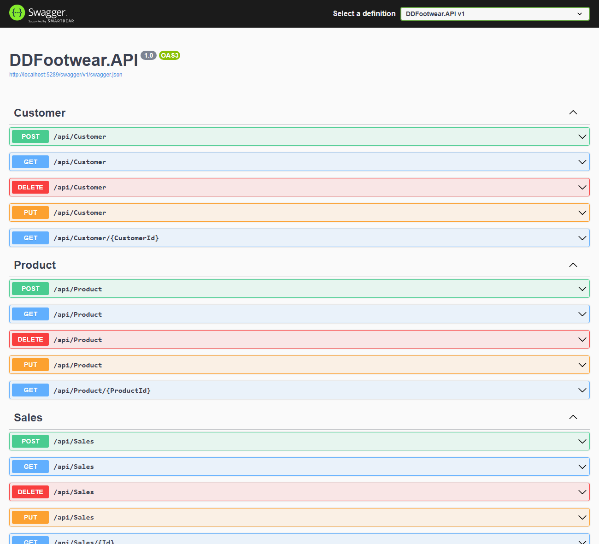
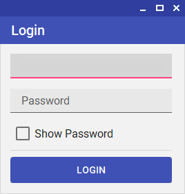
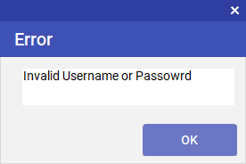
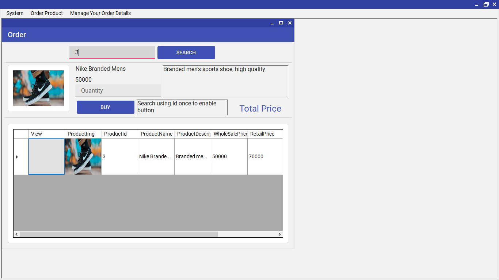
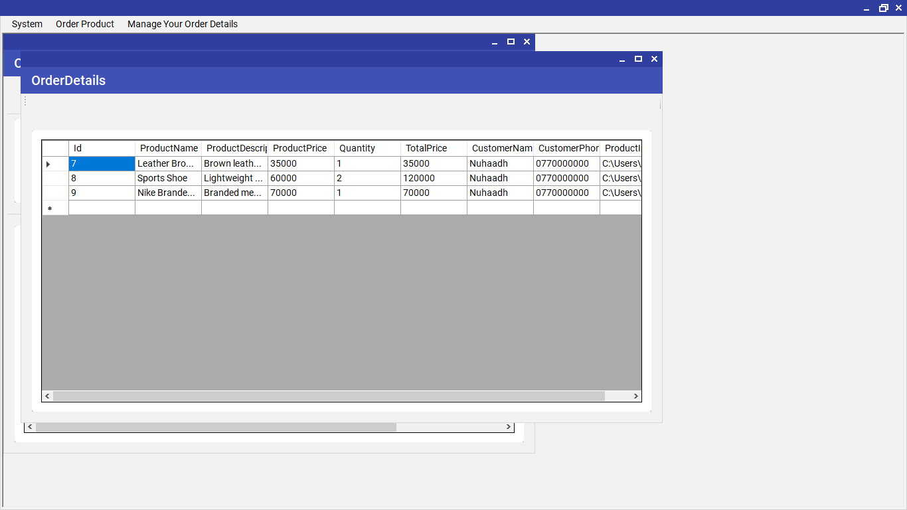
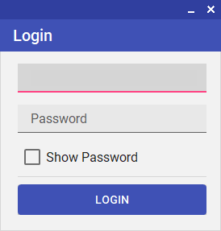
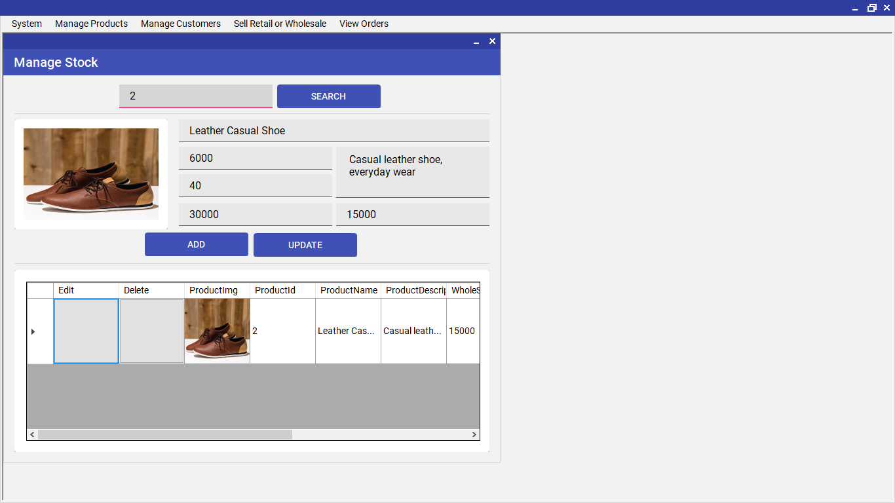
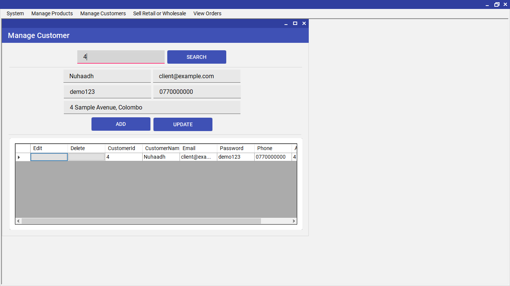
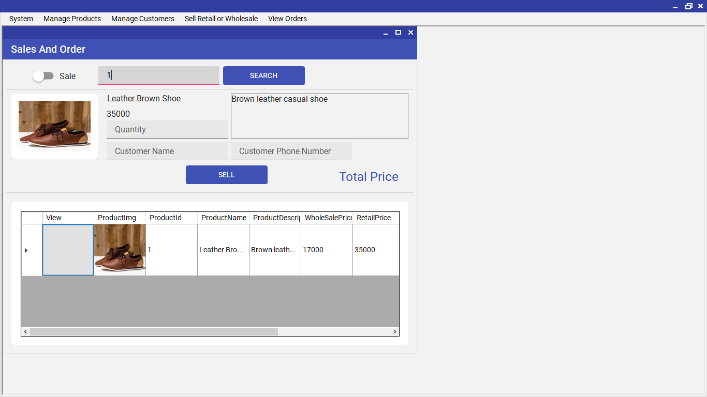
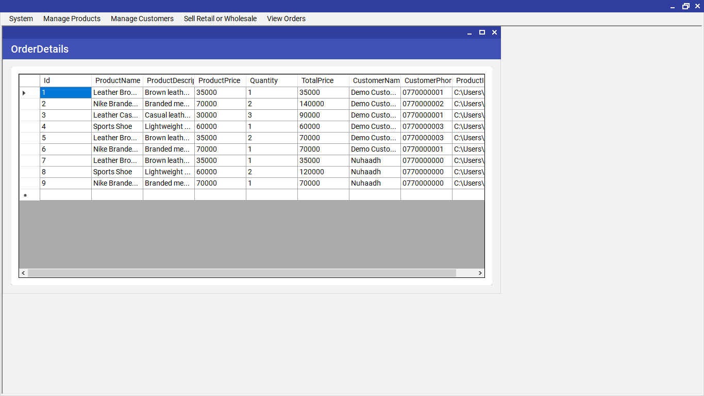

# DDFootwear: Footwear Sales System

My HND final project: a footwear sales system made of three parts that work together, a
**REST API**, a **customer-facing client app** and a **distributor (admin) app**. All of it is
written in C#, on top of a SQL Server database.

```
DDFootwearClient.Forms ------- HTTP -----> DDFootwear.API ---- EF Core ----> SQL Server
DDFootwearDistributors.Forms -- HTTP ---->  (products, customers, sales)      (DDFootwear)
        |                                                                          ^
        +--------- typed datasets (e.g. the order listing) ------------------------+
```

| Folder | What it is | Stack |
| --- | --- | --- |
| [`DDFootwear.API`](DDFootwear.API) | REST API for customers, products and sales | ASP.NET Core Web API (.NET 7), EF Core 7, AutoMapper, Swagger |
| [`DDFootwearClient.Forms`](DDFootwearClient.Forms) | App for the customer: browse products and place orders | WinForms (.NET Framework 4.8), MaterialSkin |
| [`DDFootwearDistributors.Forms`](DDFootwearDistributors.Forms) | App for the distributor: manage stock, customers, sales | WinForms (.NET Framework 4.8), MaterialSkin |

> **Known issues.** This is a student project and some flaws were left as written: hardcoded logins
> and connection strings, a hardcoded image path in the API, and a few rough edges in the client.
> See [Known issues](#known-issues).

## Screenshots

All screenshots are of the running apps, using the demo data in `database/DDFootwear-demo.sql`.

### API (Swagger)



### Client app

| | |
| --- | --- |
| **Login** <br>  | **Wrong password** <br>  |

**Order Product**: search a product by ID to see its picture, price and details:



**Manage Your Order Details**: the orders placed by the client's customer:



### Distributor app

**Login**:



**Manage Products** (searching product 2):



**Manage Customers** (searching customer 4):



**Sell Retail or Wholesale** (searching product 1):



**View Orders**: every sale in the database:



## Logins

Both are hardcoded in each app's `Login.cs`. There is no sign-up screen.

| App | Username | Password |
| --- | --- | --- |
| Client app | `Nuhaadh` | `123456` |
| Distributor app | `admin` | `admin` |

The demo customers in the database all use the password `demo123`.

## What each part does

### DDFootwear.API

Endpoints (all under `/api`):

| Resource | Methods |
| --- | --- |
| `Customer` | `POST`, `GET`, `GET /{CustomerId}`, `PUT`, `DELETE` |
| `Product` | `POST` and `PUT` (multipart form with an image upload), `GET`, `GET /{ProductId}`, `DELETE` |
| `Sales` | `POST`, `GET`, `GET /{Id}`, `PUT`, `DELETE` |

The code is layered the way it was taught in class (the whiteboard is in
[`docs/class-notes-whiteboard.jpg`](docs/class-notes-whiteboard.jpg)): `Model` (entities) then
`DTO` (create and read shapes) then `Profiles` (AutoMapper) then `Data` (repository interface,
repository class and `AppDbContext`), with the controllers on top. EF Core migrations
(`first`, `second`, `third`) are in `Migrations/`.

### DDFootwearClient.Forms

- **Order Product**: loads all products from the API, search by product ID, shows the picture,
  price and description, takes a quantity and works out the total. **Buy** creates a sale through
  the API and reduces the product's stock.
- **Manage Your Order Details**: lists the sales of the customer `Nuhaadh`. The name is fixed
  in the app (see Known issues).

### DDFootwearDistributors.Forms

- **Manage Products**: search, add, update and delete products, including picture upload
  (through the API).
- **Manage Customers**: search, add, update and delete customers (through the API).
- **Sell Retail or Wholesale**: search a product, then switch between **Sale** (retail price)
  and **Order** (wholesale price) and record the sale.
- **View Orders**: lists every sale, read straight from the database through a typed dataset.

## Getting started

### Requirements

- Windows, Visual Studio 2022 with the ".NET desktop development" and "ASP.NET and web
  development" workloads
- .NET 7 runtime/SDK (the API targets `net7.0`) and the .NET Framework 4.8 developer pack
- SQL Server or SQL Server LocalDB
- NuGet access on first build (EF Core and friends for the API, MaterialSkin 2.2.3.1 for the apps)

### 1. Create the database

The demo script creates the `DDFootwear` database, its tables and some made-up data. The
Products and Sales tables store full image paths, so first tell the script where the API's
product images are (the four sample images ship in `DDFootwear.API/DDFootwear.API/Resources/images`).

PowerShell:

```powershell
$env:ImageDir = "C:\path\to\DDFootwear.API\DDFootwear.API\Resources\images"
sqlcmd -S "(localdb)\MSSQLLocalDB" -E -i database\DDFootwear-demo.sql
```

Command Prompt: use `set ImageDir=C:\path\to\...\images` instead of the first line. Use
`-S localhost` instead of `(localdb)\MSSQLLocalDB` for a full SQL Server install. Run it on a
fresh server, because it fails if the tables already exist. All names, emails and phone numbers
in the script are fictional.

The tables are the ones the EF Core migrations create, and the script records the three
migrations as applied, so `dotnet ef` will not try to create them again.

### 2. Point the code at your server

The connection strings point at `localhost`, the default SQL Server instance on your own machine.
If your SQL Server is a named instance, or LocalDB (`(localdb)\MSSQLLocalDB`), change `localhost` in these files:

- `DDFootwear.API/DDFootwear.API/Program.cs` and `Data/AppDbContext.cs`
- `App.config`, `Properties/Settings.settings` and `Properties/Settings.Designer.cs` in **both**
  WinForms apps (in `Settings.Designer.cs` the backslash must be doubled: `(LocalDB)\\MSSQLLocalDB`)

Searching the solution for `Data Source=localhost` finds all of them (8 files).

Also open `Controllers/ProductController.cs` in the API and change the hardcoded
`C:\Users\nuhaa\source\repos\DDFootwear.API\...` image folder (two places) to your own, or
products you add will point at a folder that does not exist.

### 3. Run it, in this order

1. **API**: open `DDFootwear.API/DDFootwear.API.sln` and run the `https` profile, or from a
   terminal:

   ```
   cd DDFootwear.API\DDFootwear.API
   dotnet run --launch-profile https
   ```

   Swagger opens at `https://localhost:7270/swagger`. Both apps call `https://localhost:7270`,
   so trust the development certificate once with `dotnet dev-certs https --trust`.
2. **Client app**: open `DDFootwearClient.Forms/DDFootwearClient.Forms.sln`, restore the NuGet
   packages and press F5.
3. **Distributor app**: the same with `DDFootwearDistributors.Forms/DDFootwearDistributors.Forms.sln`.

## Project layout

```
DDFootwear.API/                 API solution (Controllers, Data, DTO, Model, Profiles, Migrations)
DDFootwearClient.Forms/         Client app solution (Login, HomePage, Order, OrderDetails)
DDFootwearDistributors.Forms/   Distributor app solution (Login, HomePage, ManageStock,
                                ManageCustomer, SalesAndOrder, OrderDetails)
database/DDFootwear-demo.sql    Tables and fictional demo data
docs/                           EF Core command notes and the class whiteboard photo
screenshots/                    Images used in this README
```

## Changes from the original

The first commit is the project as I wrote it, with one edit: a personal phone number that was
hardcoded in `DDFootwearClient.Forms/Order.cs` was replaced by the placeholder `0770000000`.
The second commit fixes one bug: the distributor app started on the **Manage Stock** screen
instead of **Login**, so the login screen and the menu (customers, sales, orders) could never
be reached. `Program.cs` now starts `Login`.

## Known issues

These are left as they were written:

- **Hardcoded logins and connection strings.** The usernames and passwords are compared as plain
  text in `Login.cs`, and the SQL Server name is written into the code. Fine for a demo, not for
  real use.
- **Passwords are stored in plain text and returned by the API.** The `Customers` table keeps
  the password as text, and `GET /api/Customer` includes it in its response.
- **Hardcoded image folder in the API.** Adding or updating a product stores the path
  `C:\Users\nuhaa\source\repos\DDFootwear.API\...`, so it only works on the original machine
  until you edit `ProductController.cs`.
- **The client is fixed to one customer.** Every order is saved for the customer `Nuhaadh` with
  the placeholder phone `0770000000`, and "Manage Your Order Details" only lists that customer's
  sales (the filter is written into the dataset's query).
- **Thumbnails on the client's Order screen.** The product grid can show a red X in the image
  column when the screen first opens. Searching a product shows its picture correctly.
- **Out-of-support framework.** The API targets .NET 7, which no longer gets security updates.
